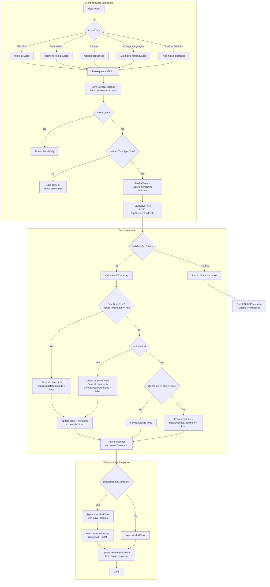
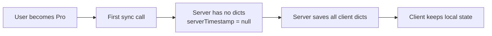
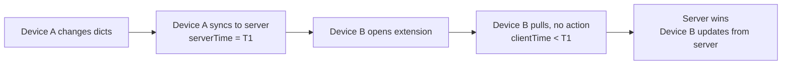
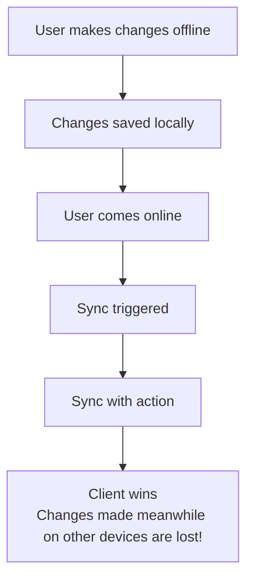
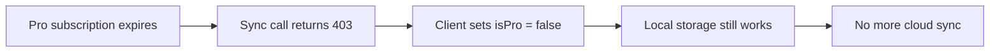
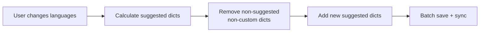
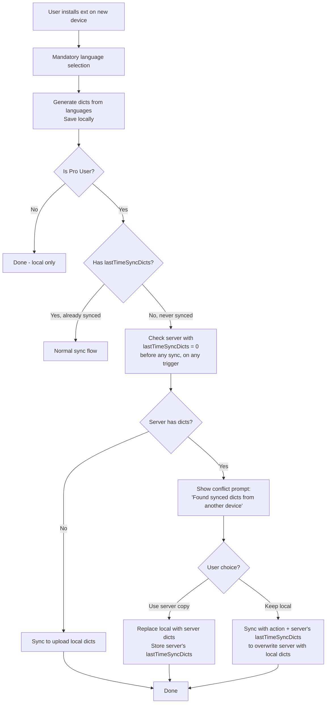

# Dictionary Sync Flow

## Overview

This document describes the synchronization flow between the client (browser extension) and server (pnl.dev cloud) for Pro users' dictionary lists.

## Simplified Sync Model (Proposed)

The sync model is **full state sync** - client always sends complete `allDicts` array. `lastTimeSyncDicts` on the client only ever holds a time the server returned; the client never writes its own clock into it. A local change is signalled with `action` instead.



## Edge Cases

### Edge Case 1: New Pro User



### Edge Case 2: Multi-Device Sync



### Edge Case 3: Offline Changes



### Edge Case 4: Pro Expires



### Edge Case 5: Language Change



### Edge Case 6: New Device with Existing Server Data



**Key Point**: For Pro users on a device that has never synced (fresh install, or a free user who became Pro):
1. **Language selection first** (always mandatory)
2. Generate local dicts from selected languages
3. If never synced before, **check server** (with timestamp = 0). Every sync does this first, whether it is a pull or a local change, so neither side overwrites the other before the user decides. The options page shows the conflict prompt whenever it finds one, not only in the welcome dialog.
4. If server has data → **ask user**: "Use server copy?" or "Keep local?"
   - Use server copy → replace local dicts with server dicts
   - Keep local → overwrite server with local dicts
5. If server has no data → sync to upload local dicts

Language selection happens **before** the sync check, so server data doesn't affect language choice.

## Data Flow Summary

| Trigger | Local Storage | Cloud Sync |
|---------|--------------|------------|
| Add dict | Append to storage | Full sync |
| Remove dict | Remove from storage | Full sync |
| Reorder | Update all sequences | Full sync |
| Change languages | Batch remove + add | Full sync |
| Open options page | Read only | Full sync (get latest) |

## Key Simplifications

1. **No incremental sync** - Always send full `allDicts` state
2. **Last writer wins** - a sync with `action` overwrites the server; a sync without it takes the server's version unless the timestamps match. Older extensions that send `Date.now()` without `action` still win when their time is newer than the server's
3. **Batch local storage** - Use `removeAll` + `setAll` instead of individual operations
4. **Single sync call** - No separate add/remove actions, just full state sync

## Custom Dict Protection

Custom dicts (installed from pnl.dev with `troveUrl` property) are **never removed** during language sync:

```javascript
// Only remove if: NOT in suggested AND NOT a custom dict
if (!suggestedDictNames.has(dict.dictName) && !dict.troveUrl) {
    remove(dict);
}
```
